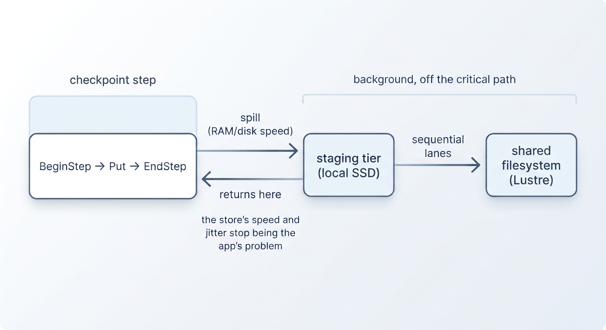

# bbstage

**bbstage** is a write-only ADIOS2 engine that speeds up application checkpoints. 

Instead of waiting on a slow shared filesystem, `bbstage` writes each checkpoint step to fast local storage (like node-local NVMe or RAM). Background workers then copy that data to your final storage in large, sequential writes while your application keeps computing.

The output uses the standard **BP5** format. You can read your data back with the default `bp5` engine, `bpls`, or any standard BP5 reader.

*Figure: Checkpoint steps write to fast local storage and return immediately. Background workers move the data to the shared filesystem off the critical path.*

!!! info "When to use bbstage"
    * **What it is:** Protection against shared storage slowdowns. When storage traffic is heavy, `bbstage` absorbs the delay in the background so your simulation does not stall.
    * **What it is not:** A magic speedup when the filesystem is idle. Because `bbstage` makes an extra local copy of every checkpoint, it matches normal `bp5` speeds on quiet days. Its main value is preventing sudden slowdowns, improving metadata behavior, and managing heavy I/O traffic.

---

## Close Modes

You can choose when `Close()` returns to your application depending on your safety needs:

| Mode | When `Close()` returns | Data safety on return |
| :--- | :--- | :--- |
| **`durable`** *(default)* | After all data is copied and committed to final storage. | **Complete.** All bytes are safely on the final filesystem. |
| **`staged`** | As soon as the final step reaches local storage. | **Partial.** Background copies may still be running. A checkpoint is complete only when a `bbstage.final` file appears inside it — key readers, archivers, and any delete-on-restart scripts on that marker. See [Semantics & Durability](semantics.md). |

---

## Performance Overview

As long as your checkpoints fit within the local buffer and background copy limits, a checkpoint only costs `S / B` (data size divided by local storage speed). Slowdowns on the shared filesystem will not affect your application's runtime. That statement is [the main equation](tuning.md#equation) of this page's measurements — everything below quantifies its terms.

The numbers below come from real benchmarks on Lustre filesystems (see [Tuning by Measurement](tuning.md) and [Methodology](methodology.md) for job IDs):

| Metric | Measured Speed | What affects it |
| :--- | :--- | :--- |
| **Local staging speed** | `1.9 – 5.5 GiB/s` (NVMe) `8 – 50 GiB/s` (`/dev/shm`) | Node hardware (test your node when a job starts). |
| **Background drain speed** | `0.24 – 0.43 GiB/s` per worker *(~3× faster for ~1 GiB files)* | Target filesystem path and file size. |
| **Shared store capacity** | `Per-stream rate × stream count` | I/O concurrency (buffered vs. `O_DIRECT` is ~25× different), stream count, and store load. |
| **Checkpoint speedup** | **`3.4×` faster** under heavy load **`1.0×`** on an idle store | Current traffic on the shared filesystem. |

---

## Related Projects

* **[bblite](https://github.com/denisbertini/bblite):** Applies this same local-staging design below the application layer as a lightweight `LD_PRELOAD` library for POSIX I/O.
* **BBView** *(Koyama & Tatebe, REX-IO 2025)*: The research lineage that inspired `bbstage`. Unlike BBView, `bbstage` runs entirely inside your application process and writes data directly in BP5 format, so background workers only need to copy bytes and commit metadata.

---

## Project Status & Repository Layout

`bbstage` is maintained as a clean, minimal fork of ADIOS2 (`master = upstream + bbstage`), making it easy to stay up to date with upstream releases.

* **Engine code:** `source/adios2/engine/bbstage/` (plus minor registration edits)
* **Tests:** `testing/adios2/engine/bbstage/` (enable with `-DADIOS2_BUILD_TESTING=ON`)
* **Capabilities:** Write-only engine using POSIX local staging. Use the standard `bp5` engine for reading.

[Get started with the Quickstart guide →](quickstart.md)
